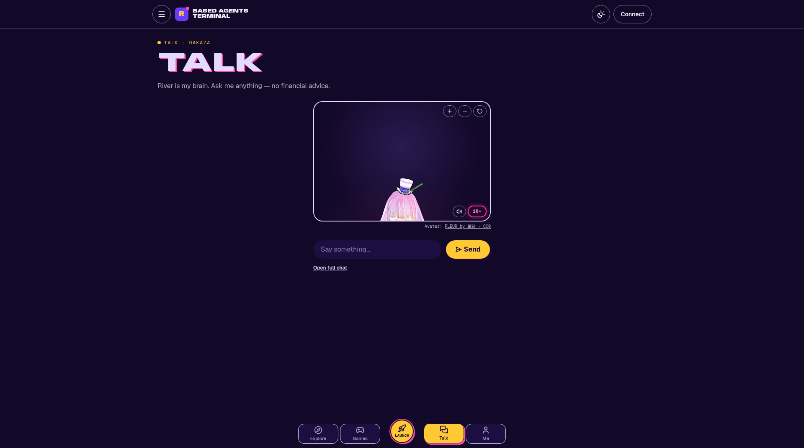
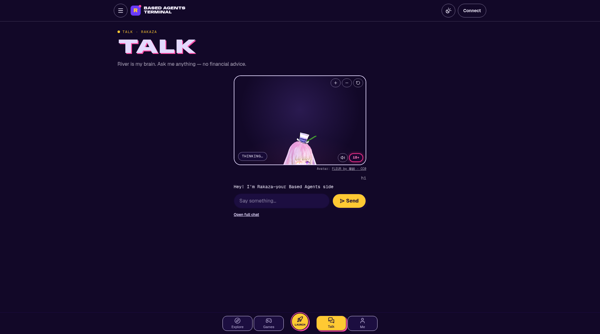
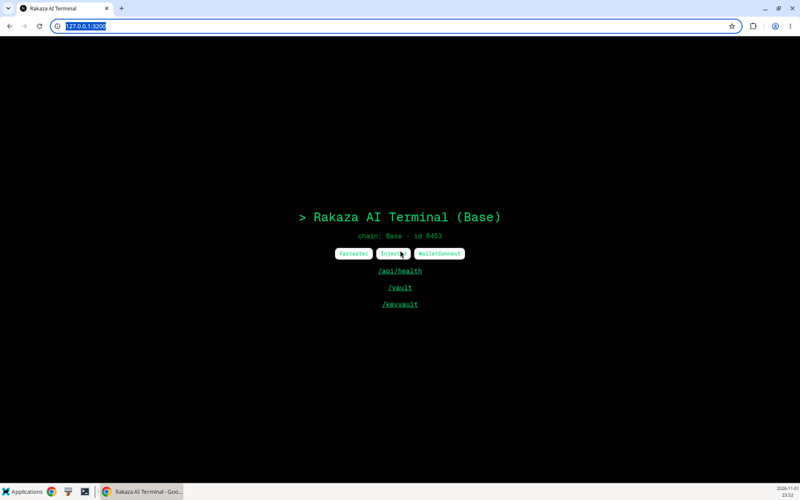
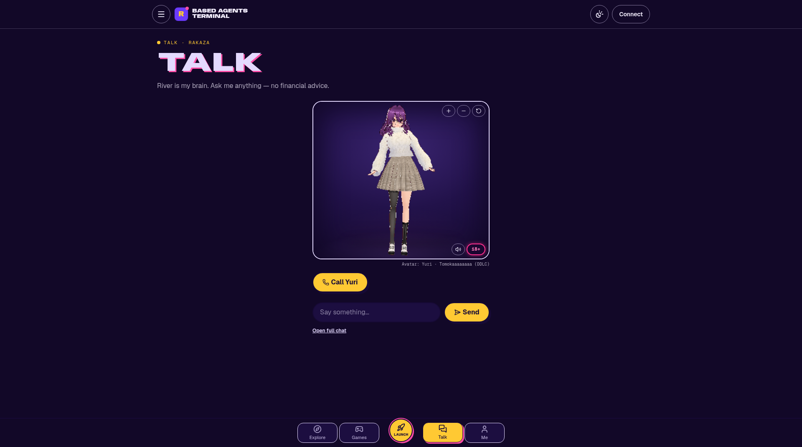
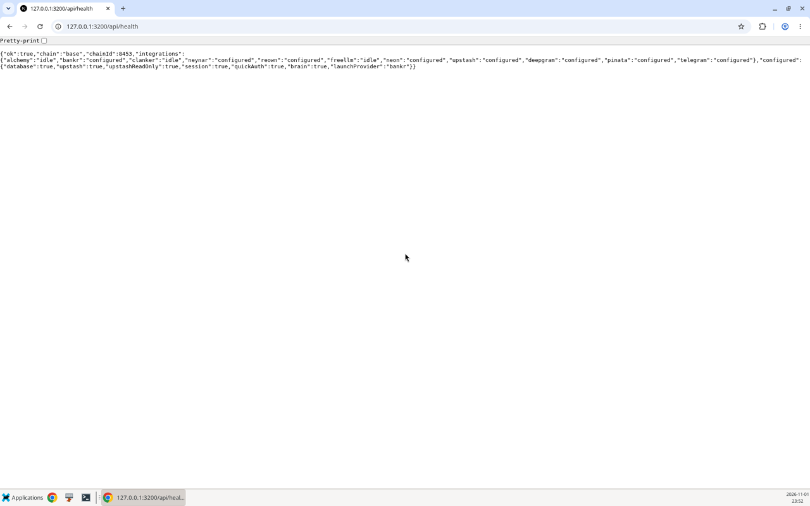
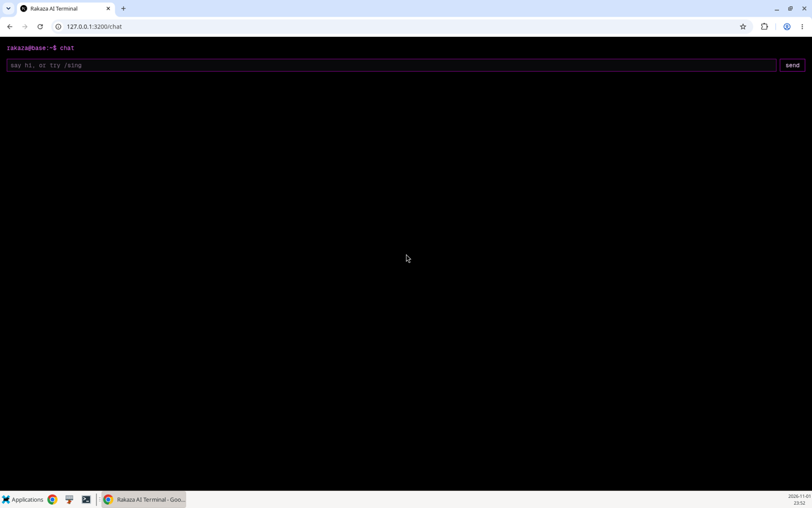
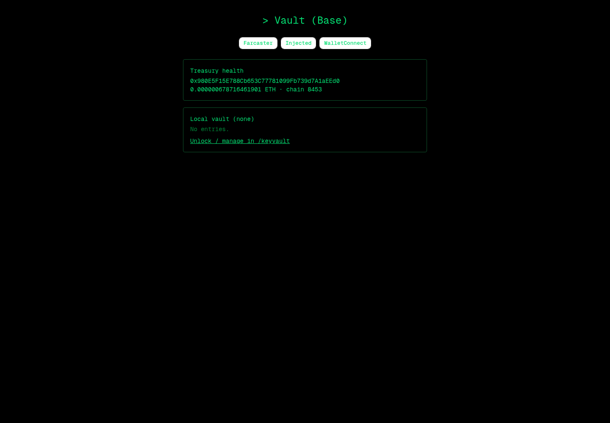
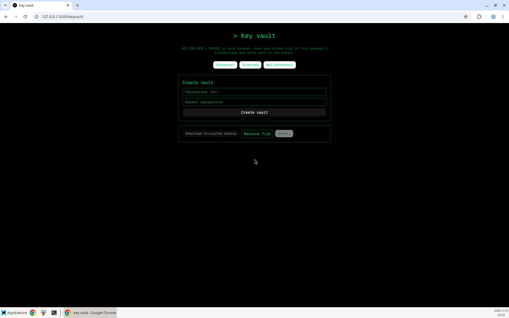

# Based Agents Terminal

**Launch, run, and talk to AI agents on Base (chain 8453) — as a web terminal and a Farcaster Mini App.**
Sponsored token launches via Bankr, self-launch, an encrypted vault, agent tools, a Telegram bot, and a live 3D VRM avatar you can talk to.

- **Live:** https://rakazaibase.vercel.app
- **Talk to the avatar:** https://rakazaibase.vercel.app/talk
- **Repo:** https://github.com/Maliot100X/RakazAIBase

| Talk — idle | Talk — speaking |
|---|---|
|  |  |



## Features

- **Bankr sponsored launch (70/30)** — platform-sponsored token launches on Base with a 70/30 fee split.
- **Self-launch** — launch from your own wallet, with a small service fee.
- **River → OpenAI brain** — agent reasoning routed through River, falling back to OpenAI-compatible models.
- **Talk: 3D VRM avatar** — real-time voice/chat with a lip-synced VRM avatar (Yuri, `/avatar/rakaza.vrm`).
- **Vault crypto** — per-user keys encrypted server-side with `TREASURY_ENCRYPTION_KEY`.
- **Agent tools** — search, scraping, image generation, on-chain reads and actions.
- **Telegram bot** — run the agent from Telegram; owner commands are gated by `TELEGRAM_ADMIN_ID`.
- **Farcaster Mini App** — 424×695 embedded frame with Quick Auth and the wagmi connector.

## Screens

| Talk | Health |
|---|---|
|  |  |

| Chat | Vault | Key vault |
|---|---|---|
|  |  |  |

## Avatar

- Model file: `public/avatar/rakaza.vrm` → served at **`/avatar/rakaza.vrm`**
- Talk UI: **`/talk`**
- Credit: **Yuri** (VRM 1.0) by **Tomokaaaaaaaa**, a fan model of Yuri from *Doki Doki Literature Club* (Team Salvato). Redistribution and commercial use are allowed. **NSFW/lewd use is not allowed.** Credit **Dan Salvato**. Full terms are in [`public/avatar/LICENSE.md`](public/avatar/LICENSE.md). Backup models (FLEUR CC0, VRoid samples) are listed there too.

## Local setup

```bash
git clone https://github.com/Maliot100X/RakazAIBase.git
cd RakazAIBase
cp .env.example .env.local   # fill in your keys
npm i
npm run build
npm start                    # next start -p 3200 → http://localhost:3200
```

Dev mode: `npm run dev` (port 3200). Checks: `npm run lint`, `npm run typecheck`.

## Environment highlights

Names only. Put the real values in `.env.local` and never commit that file.

| Group | Variables |
|---|---|
| Bankr | `BANKR_API_KEY`, `BANKR_API_URL` |
| Execution switches | `EXECUTE_ENABLED`, `SPONSORED_ENABLED`, `SELF_LAUNCH_ENABLED` |
| Brain | `RIVER_BASE_URL`, `RIVER_AGENT`, `RIVER_MODEL_AGENT`, `RIVER_MODEL_PERSONA`, `OPENAI_API_KEY`, `OPENAI_BASE_URL` |
| Treasury | `PLATFORM_TREASURY_ADDRESS`, `PLATFORM_TREASURY_PRIVATE_KEY`, `TREASURY_ENCRYPTION_KEY` |
| Telegram | `TELEGRAM_BOT_TOKEN`, `TELEGRAM_ADMIN_ID`, `TELEGRAM_MOCK` |
| Farcaster | `FARCASTER_HEADER`, `FARCASTER_PAYLOAD`, `FARCASTER_SIGNATURE` (sign these after the domain is final) |

## Notes

- **Clanker** stays idle until `CLANKER_API_KEY` is set.
- Set **`TELEGRAM_ADMIN_ID`** to your Telegram user ID to unlock owner commands.
- The **Farcaster manifest** is unsigned until you sign it for your production domain and set the `FARCASTER_*` vars.
